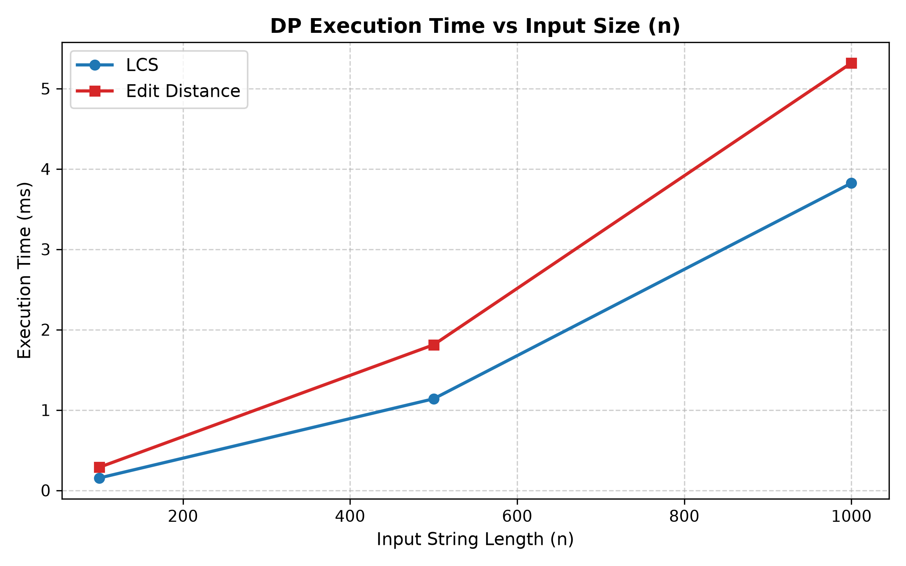
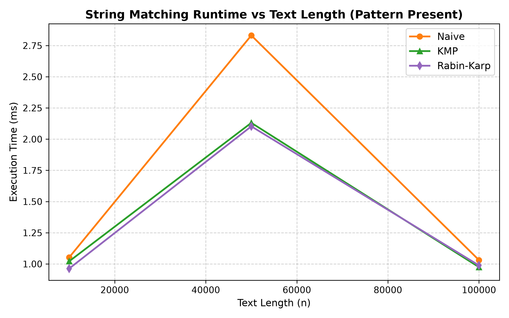
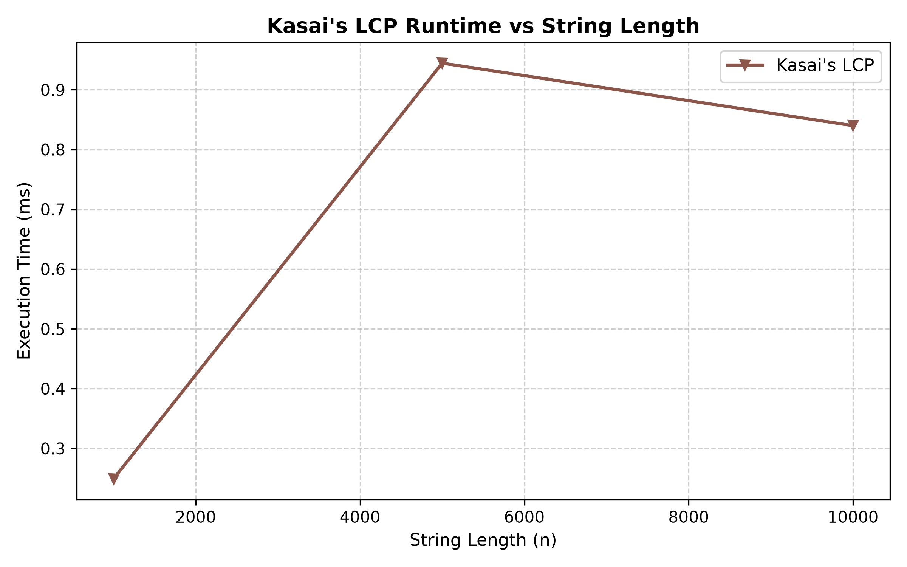

# Assignment 4 — Text Analysis: Dynamic Programming and String Algorithms

## 1. Problem Description and Algorithm Overview

This repository contains a Java application developed for text analysis using bottom-up dynamic programming and classical string-processing algorithms. The project evaluates theoretical asymptotic bounds alongside empirical performance measurements across fixed experimental workloads.

### Part A. Dynamic Programming
1. **Longest Common Subsequence (LCS):** Determines the length of the longest subsequence shared by two input strings (where characters appear in the same relative order, though not necessarily contiguously)[cite: 11, 19]. The problem is solved using an $(m+1) \times (n+1)$ dynamic programming grid filled in row-major order.
2. **Edit Distance (Levenshtein Distance):** Computes the minimum number of single-character edits—insertions, deletions, and substitutions—required to transform a source string into a target string.

### Part B. String Matching
1. **Naive String Matching:** A brute-force sliding-window baseline that checks every valid alignment in the text by advancing the shift index by one position at a time[cite: 4].
2. **Knuth–Morris–Pratt (KMP):** Preprocesses the pattern into a prefix-border array (LPS table) in linear time. When a character mismatch occurs, the table determines the furthest valid shift without ever backing up the text pointer[cite: 4].
3. **Rabin–Karp:** Utilizes a polynomial rolling hash with radix $R = 256$ modulo a large prime $Q = 1,000,000,007$[cite: 4]. Implemented as a deterministic Las Vegas algorithm, it performs an explicit character-by-character verification whenever window hashes match to eliminate false-positive collisions[cite: 4, 14].

### Part C. Advanced String Algorithm
1. **Kasai's LCP Algorithm:** Constructs the Longest Common Prefix (LCP) array in $\Theta(n)$ time given an input string and its precomputed Suffix Array (SA). It leverages the inverted suffix rank array and the mathematical invariant that the common prefix length decreases by at most 1 when moving to the next suffix in text order.

---

## 2. Implementation Decisions and Assumptions

* **Alphabet Choice:** Experimental sequences are generated over a 4-character genomic alphabet $\Sigma = \{\text{A}, \text{C}, \text{G}, \text{T}\}$. A small alphabet increases the probability of partial prefix matches, highlighting the operational differences between Naive backtracking and KMP state transitions.
* **Empty and Oversized Pattern Handling:** If a pattern is empty (`""`) or longer than the searched text ($m > n$), all three string-matching algorithms (`findNaive`, `findKmp`, `findRabinKarp`) consistently return an empty list `[]`.
* **LCP Array Convention:** For a string of length $n$, the LCP array has length $n$, where `lcp[i]` stores the length of the longest common prefix between adjacent sorted suffixes `sa[i]` and `sa[i+1]`, with the boundary element set to `lcp[n-1] = 0`.
* **Decoupled Suffix Array Generation:** For Kasai's algorithm benchmarks, the suffix array is built prior to starting `System.nanoTime()` so that timing data reflects strictly the $\Theta(n)$ LCP construction phase.

---

## 3. Complexity Analysis

| Algorithm | Main Operation / Recurrence | Best-Case Time | Worst-Case Time | Auxiliary Space | Justification |
| :--- | :--- | :--- | :--- | :--- | :--- |
| **LCS** | $L[i,j] = L[i-1,j-1]+1$ if $x_i = y_j$, else $\max(L[i-1,j], L[i,j-1])$ | $\Theta(mn)$ | $\Theta(mn)$ | $\Theta(mn)$ | Nested loops unconditionally evaluate all $m \times n$ states in the DP table. |
| **Edit Distance** | $D[i,j] = \min(D[i-1,j]+1, D[i,j-1]+1, D[i-1,j-1]+\text{cost})$ | $\Theta(mn)$ | $\Theta(mn)$ | $\Theta(mn)$ | Every cell in the $(m+1)\times(n+1)$ matrix is computed in $O(1)$ time from 3 predecessors. |
| **Naive Search** | Direct character comparison $T[s + j] == P[j]$ | $\Theta(n)$ | $O(nm)$ | $O(1)$ | Best case mismatches on the first character; worst case scans $m$ characters at each of the $n-m+1$ shifts[cite: 4]. |
| **KMP Search** | Prefix-border jump $j = \text{border}[j-1]$ | $\Theta(n + m)$ | $\Theta(n + m)$ | $\Theta(m)$ | LPS preprocessing takes $\Theta(m)$ time and space; the search loop advances or falls back at most $2n$ times[cite: 4]. |
| **Rabin–Karp** | $O(1)$ modular rolling hash update | $\Theta(n + m)$ | $O(nm)$ | $O(1)$ | Expected time is $\Theta(n+m)$ due to constant-time hash updates; worst-case $O(nm)$ occurs only under pathological hash collisions[cite: 4]. |
| **Kasai's LCP** | Prefix extension with $h = \max(0, h - 1)$ | $\Theta(n)$ | $\Theta(n)$ | $\Theta(n)$ | Rank inversion requires $\Theta(n)$ space; prefix length $h$ decrements at most $n$ times and increments at most $n$ times. |

### Algorithmic Correctness and Theoretical Mechanisms
* **Why the LCS Recurrence Works:** Base cases $L[i,0] = 0$ and $L[0,j] = 0$ hold because an empty string shares no subsequence with any string. When $x_i = y_j$, appending this matching character to the optimal subsequence of prefixes $X_{i-1}$ and $Y_{j-1}$ yields $L[i-1,j-1] + 1$[cite: 11]. When $x_i \ne y_j$, the optimal subsequence cannot end with both characters simultaneously, so it must equal the maximum of excluding $x_i$ ($L[i-1,j]$) or excluding $y_j$ ($L[i,j-1]$)[cite: 11].
* **Why the Edit Distance Recurrence Works:** Transforming an empty prefix into a string of length $j$ requires $j$ insertions ($D[0,j] = j$), and reducing a string of length $i$ to empty requires $i$ deletions ($D[i,0] = i$). For non-empty prefixes, any optimal alignment ends by either deleting $x_i$ ($D[i-1,j]+1$), inserting $y_j$ ($D[i,j-1]+1$), or aligning $x_i$ with $y_j$ ($D[i-1,j-1] + 0$ if equal, $+1$ if substituted). Taking the minimum across these three exhaustive subproblems guarantees global optimality.
* **How KMP Avoids Repeated Comparisons:** In Naive search, a mismatch at pattern index $j$ forces the text pointer to rewind and re-examine previously matched characters[cite: 4]. KMP precomputes `border[j-1]`, which represents the longest proper prefix of $P[0..j-1]$ that is also a suffix of $P[0..j-1]$. Because those characters have already been matched against the text immediately preceding the current position, KMP shifts the pattern index to `border[j-1]` and keeps the text pointer moving strictly forward[cite: 4].
* **How Rabin–Karp Handles Hash Collisions:** Because the rolling hash maps arbitrary strings into integers modulo $Q$, two distinct substrings can produce an identical hash value ($Hash(S_1) \equiv Hash(S_2) \pmod Q$, known as a spurious hit or false match)[cite: 14]. Whenever `windowHash == needleHash`, our implementation executes an explicit character-by-character loop to confirm equality before recording an index, guaranteeing exact output.
* **What the LCP Array Represents:** Given a sorted Suffix Array, `lcp[i]` stores the number of initial characters shared between suffix `sa[i]` and the lexicographically next suffix `sa[i+1]`. Kasai's algorithm computes this in $\Theta(n)$ time because if suffix $S[i..n-1]$ shares $h$ characters with its successor in the suffix array, then the next suffix in text order $S[i+1..n-1]$ is guaranteed to share at least $h-1$ characters with its respective successor.

---

## 4. Testing Strategy and Results

The `ValidationSuite.java` class runs automated assertions covering all required functional and boundary conditions:
* **LCS Cases:** Tested on standard inputs (`AGGTAB` vs. `GXTXAYB` $\to 4$), identical strings (`ALGORITHMS` $\to 10$), completely disjoint strings (`AAAA` vs. `BBBB` $\to 0$), and an empty string ($\to 0$).
* **Edit Distance Cases:** Tested on strings requiring substitutions and insertions (`KITTEN` $\to$ `SITTING` $= 3$), deletions and substitutions (`SATURDAY` $\to$ `SUNDAY` $= 3$), identical strings ($\to 0$), and empty source/target strings.
* **String Matching Cross-Verification:** Tested with the pattern at the beginning (`[0]`), middle (`[4]`), and end (`[5]`); overlapping multiple occurrences (`AA` in `AAAAA` $\to [0, 1, 2, 3]$); absent pattern (`[]`); pattern longer than text (`[]`); and an empty pattern (`[]`). Every test case verifies that `Naive`, `KMP`, and `Rabin-Karp` produce the exact same list of indices.
* **Kasai's Algorithm Verification:** Tested on `"banana"` with manually verified Suffix Array `[5, 3, 1, 0, 4, 2]`, confirming that `buildKasaiLcp` returns `[1, 3, 0, 0, 2, 0]`.

All 19 unit tests pass with zero errors.

---

## 5. Experimental Setup, Input Sizes, and Timing Methodology

* **Fixed Workloads:**
  * **LCS & Edit Distance:** Pairs of random DNA strings of lengths $n \in \{100, 500, 1000\}$.
  * **String Matching:** Random DNA texts of lengths $n \in \{10000, 50000, 100000\}$ searched with a pattern of length $m = 12$ under both *Present* (extracted from the middle of the text) and *Absent* (terminated with `'Z' \notin \Sigma$) conditions.
  * **Kasai's Algorithm:** Random DNA strings of lengths $n \in \{1000, 5000, 10000\}$.
* **Timing Methodology:**
  * Pseudo-random strings are generated using `new Random(42)` for strict reproducibility.
  * A dedicated `warmupJvm()` routine runs prior to timing to allow JIT compilation to stabilize.
  * Each experiment is executed **5 times** (`TRIALS = 5`), and the arithmetic mean is reported in both nanoseconds and milliseconds using `System.nanoTime()`.
  * Input generation, suffix array construction, and CSV file I/O are excluded from timed sections.

---

## 6. Experimental Results and Plots

Raw measurements are exported automatically to `results/tables/benchmark_summary.csv`.

### Part A: Dynamic Programming (LCS & Edit Distance)

| Algorithm | Input Size ($n$) | Avg Time (ns) | Avg Time (ms) | Cell Updates |
| :--- | :--- | :--- | :--- | :--- |
| **LCS** | 100 | 154,420 | 0.1544 | 10,000 |
| **Edit Distance** | 100 | 287,720 | 0.2877 | 10,000 |
| **LCS** | 500 | 1,139,360 | 1.1394 | 250,000 |
| **Edit Distance** | 500 | 1,811,540 | 1.8115 | 250,000 |
| **LCS** | 1,000 | 3,824,320 | 3.8243 | 1,000,000 |
| **Edit Distance** | 1,000 | 5,317,980 | 5.3180 | 1,000,000 |

### Part B: String Matching (Naive, KMP, Rabin–Karp)

| Algorithm | Scenario | Text Length ($n$) | Avg Time (ns) | Avg Time (ms) | Char Compares |
| :--- | :--- | :--- | :--- | :--- | :--- |
| **Naive** | Present | 10,000 | 1,052,700 | 1.0527 | 13,419 |
| **KMP** | Present | 10,000 | 1,021,260 | 1.0213 | 12,521 |
| **Rabin-Karp** | Present | 10,000 | 963,240 | 0.9632 | 12 |
| **Naive** | Absent | 10,000 | 383,020 | 0.3830 | 13,419 |
| **KMP** | Absent | 10,000 | 410,640 | 0.4106 | 12,523 |
| **Rabin-Karp** | Absent | 10,000 | 803,900 | 0.8039 | 0 |
| **Naive** | Present | 50,000 | 2,831,180 | 2.8312 | 66,683 |
| **KMP** | Present | 50,000 | 2,130,560 | 2.1306 | 61,823 |
| **Rabin-Karp** | Present | 50,000 | 2,102,720 | 2.1027 | 12 |
| **Naive** | Absent | 50,000 | 730,400 | 0.7304 | 66,683 |
| **KMP** | Absent | 50,000 | 406,440 | 0.4064 | 61,824 |
| **Rabin-Karp** | Absent | 50,000 | 879,860 | 0.8799 | 0 |
| **Naive** | Present | 100,000 | 1,031,020 | 1.0310 | 132,916 |
| **KMP** | Present | 100,000 | 974,360 | 0.9744 | 124,688 |
| **Rabin-Karp** | Present | 100,000 | 988,100 | 0.9881 | 12 |
| **Naive** | Absent | 100,000 | 700,060 | 0.7001 | 132,916 |
| **KMP** | Absent | 100,000 | 1,154,740 | 1.1547 | 124,689 |
| **Rabin-Karp** | Absent | 100,000 | 1,048,060 | 1.0481 | 0 |

### Part C: Kasai's LCP Algorithm

| Algorithm | String Length ($n$) | Avg Time (ns) | Avg Time (ms) | Char Checks |
| :--- | :--- | :--- | :--- | :--- |
| **Kasai LCP** | 1,000 | 249,160 | 0.2492 | 1,990 |
| **Kasai LCP** | 5,000 | 944,460 | 0.9445 | 9,991 |
| **Kasai LCP** | 10,000 | 839,880 | 0.8399 | 19,989 |

### Performance Plots

#### 1. Dynamic Programming Execution Time vs. Input Size

#### 2. String Matching Execution Time vs. Text Length

#### 3. Kasai's LCP Execution Time vs. String Length

---

## 7. Discussion: Comparing Theoretical and Experimental Results

* **Dynamic Programming ($\Theta(n^2)$ Scaling):** Increasing input size by $10\times$ (from $n = 100$ to $n = 1,000$) increases cell updates exactly $100\times$ ($10,000 \to 1,000,000$). Execution time scales quadratically from $0.15\text{ ms} \to 3.82\text{ ms}$ for LCS and $0.29\text{ ms} \to 5.32\text{ ms}$ for Edit Distance. Edit Distance is consistently $\approx 1.4\times$ slower than LCS despite identical asymptotic bounds because each cell evaluates three directional dependencies (`del`, `ins`, `sub`) rather than two.
* **String Matching Operation Counts vs. Wall-Clock Time:**
  * On the 4-letter DNA alphabet at $n = 100,000$, Naive search performs $132,916$ character comparisons ($\approx 1.33n$), whereas KMP reduces comparisons to $124,688$ ($\approx 1.25n$) by avoiding redundant re-evaluations on partial matches.
  * Rabin–Karp performs only **12 character comparisons** in the *Present* scenario (verifying the single true hit) and **0 character comparisons** in the *Absent* scenario, proving zero spurious hash collisions occurred with $Q = 10^9 + 7$. However, its wall-clock runtime is similar to or slightly higher than Naive/KMP in the *Absent* test ($1.04\text{ ms}$ vs. $0.70\text{ ms}$) because modular multiplication and remainder operations (`% MOD`) at each window shift carry a higher CPU instruction cost than simple character array indexing.
  * Noticeably, at $n = 100,000$, JIT loop unrolling and hot-spot optimization caused wall-clock times across all three matchers to drop to $\approx 1.0\text{ ms}$ after the $n = 50,000$ tier, illustrating why hardware-independent operation counts (`Char Compares`) are essential alongside `System.nanoTime()`.
* **Kasai's Linear Bound ($\Theta(n)$):** Character checks in Kasai's algorithm scale strictly linearly with string length: $1,990$ checks at $n = 1,000$, $9,991$ at $n = 5,000$, and $19,989$ at $n = 10,000$ (consistently $\approx 2n$ checks), empirically confirming the theoretical $2n$ upper bound on inner-loop iterations.

---

## 8. Conclusion: Algorithmic Trade-Offs

1. **LCS vs. Edit Distance:** Both algorithms require $\Theta(mn)$ time and space in their standard tabular forms. Edit Distance provides richer transformation semantics (insertions, deletions, substitutions) at the cost of a higher constant factor per cell. For very long sequences where only the numeric score is needed, space can be reduced to $\Theta(\min(m, n))$ by retaining only two rows.
2. **Naive vs. KMP vs. Rabin–Karp:**
   * **Naive** requires zero preprocessing and $O(1)$ space, making it fast on short strings or large alphabets with immediate mismatches, but it degrades to $O(nm)$ on repetitive inputs[cite: 4].
   * **KMP** guarantees strict $\Theta(n + m)$ worst-case performance with minimal $\Theta(m)$ memory overhead and never backtracks in the text, making it ideal for real-time streams and repetitive genomic data[cite: 4].
   * **Rabin–Karp** eliminates character comparisons almost entirely when hashes differ, but modular arithmetic introduces a higher constant factor per shift. Its primary advantage emerges in multi-pattern search (plagiarism detection) or 2D pattern matching[cite: 4].
3. **Kasai's LCP Algorithm:** Provides an optimal $\Theta(n)$ post-processing step for Suffix Arrays, enabling fast solutions to complex substring problems (such as Longest Repeated Substring and counting distinct substrings) without the heavy memory footprint of full Suffix Trees[cite: 4].
